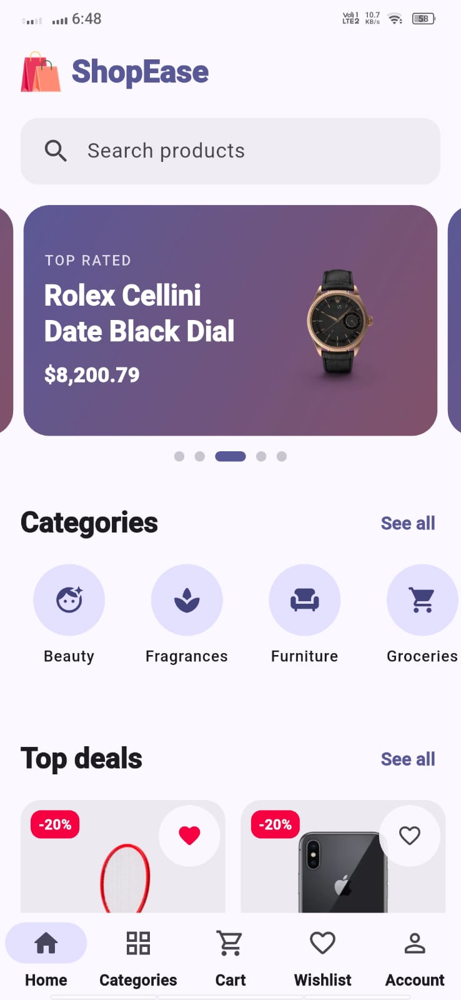
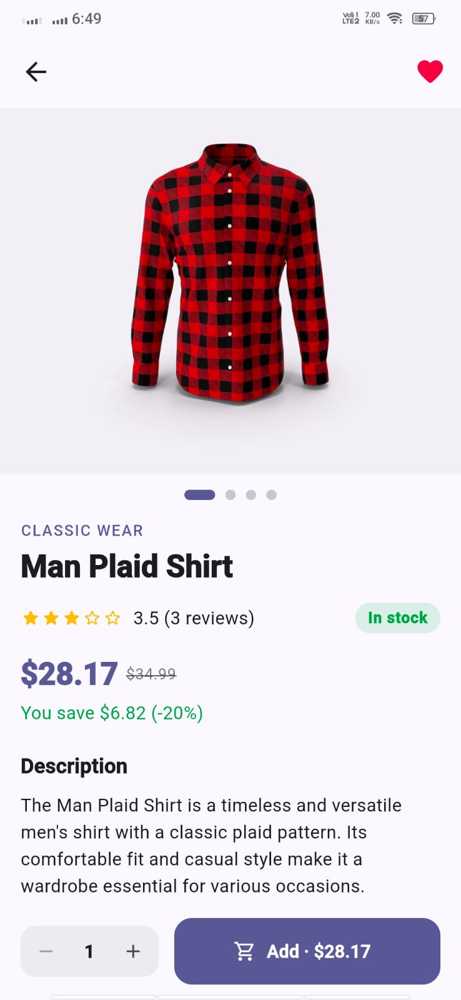
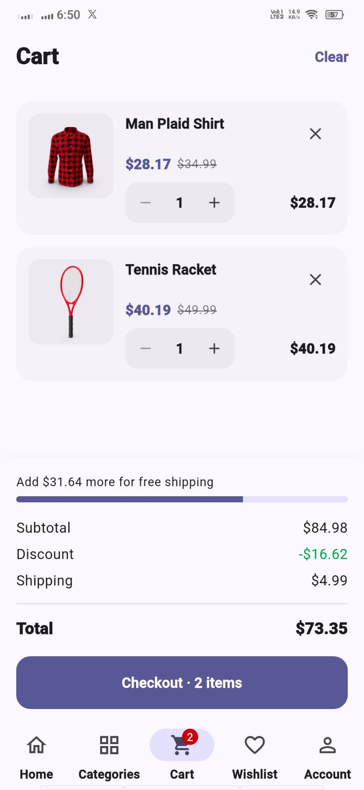
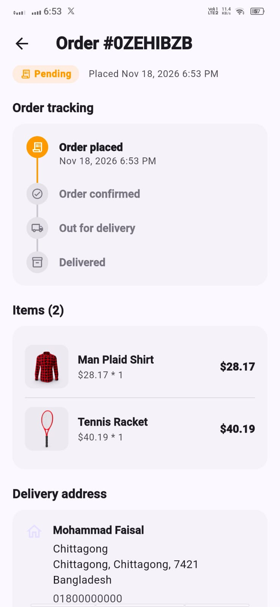
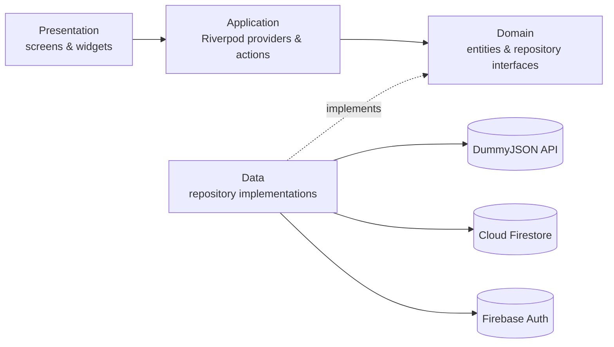

# ShopEase – Flutter E-Commerce App

A full e-commerce mobile app: product catalog, auth, cart, wishlist, checkout and order tracking, built with **Flutter, Riverpod and Firebase** using a feature-first clean architecture.


| Home | Product | Cart | Orders |
|---|---|---|---|
|  |  |  |  |

## At a glance

| | |
|---|---|
| **Type** | Portfolio project (not published to a store) |
| **Platform** | Android (Flutter) |
| **State / routing** | Riverpod (code generation), go_router |
| **Backend** | Firebase Auth, Cloud Firestore with validated security rules |
| **Catalog data** | [DummyJSON](https://dummyjson.com) REST API via Dio |
| **Quality** | Unit and widget tests, GitHub Actions CI |
| **Try it** | [Download the APK](../../releases/latest) · demo video: *add link* |

## Features

- **Shopping:** banner slider, categories, deals, new arrivals, infinite-scroll grid, debounced search with history, sorting
- **Product page:** gallery, discounts, stock status, shipping and warranty info, reviews, related products
- **Account:** email verification link, Google sign-in, password reset, edit profile, change password, delete account
- **Cart and wishlist:** live Firestore sync, stock-based quantity limits, free-shipping progress, swipe to remove with undo
- **Checkout and orders:** addresses, Cash on Delivery, order history, status timeline, cancel while pending
- **Polish:** Material 3, light/dark/system theme, skeleton loaders, retry on every error

## Engineering highlights

- **Atomic checkout.** Cart items are re-fetched to verify stock and current prices, then the order is written and the cart cleared in a single Firestore batch.
- **Snapshots, not references.** Orders, cart and wishlist store the title, price and image at the time, so past orders never change when catalog data does.
- **One error model.** Dio and Firebase exceptions are mapped to a sealed `Failure` type, so the UI never handles raw exceptions.
- **Auth-aware routing.** go_router redirects handle unverified emails, protected screens and "sign in, then return to where you were".
- **Secured data.** Firestore rules limit every user to their own documents and validate field types, sizes and order status transitions.
- **Testable layers.** Repositories sit behind interfaces; cart maths and order rules are pure Dart with unit tests.

## Architecture



```
lib/
├── app/        # app widget, router, theme, navigation shell
├── core/       # network, errors, providers, storage, utils, shared widgets
└── features/   # auth, home, products, cart, wishlist, address,
                # checkout, orders, profile, settings
```

## Tech stack

Flutter · Dart · Riverpod · go_router · Dio · freezed · json_serializable · Firebase Auth · Cloud Firestore · GitHub Actions

## Run it locally

```
flutter pub get
dart run build_runner build
dart pub global activate flutterfire_cli
flutterfire configure
flutter run
```
Then, in the Firebase console, enable **Email/Password** and **Google** sign-in, create a **Firestore** database and publish [`firestore.rules`](firestore.rules). For Google sign-in, add your debug SHA-1 and SHA-256 to the Android app.

## Tests and CI

```
flutter analyze
flutter test
```
CI runs formatting, code generation, analysis and tests on every push.

## Trade-offs

- Payments are simulated (Cash on Delivery only); the app is a demo, not a live store.
- Order status changes use a clearly labelled demo button; a real store would update status from a back office.
- Firestore rules cannot loop over lists, so only the first order item is deep-validated. Full validation would need a Cloud Function.

## Author

**Mohammad Faisal** · [GitHub](https://github.com/Faisal60177) · [LinkedIn](https://linkedin.com/in/YOUR_PROFILE)